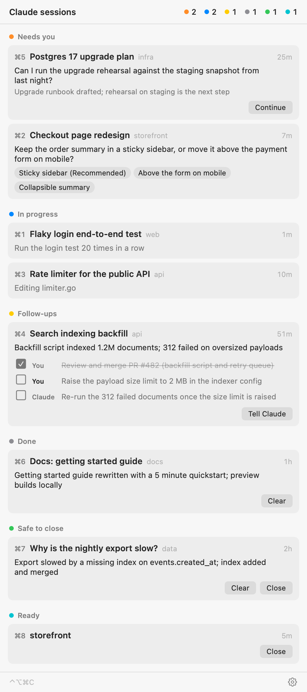

# Claude Cockpit

A macOS menu bar app that shows where every open [Claude Code](https://docs.claude.com/en/docs/claude-code) session stands: what is running, what waits on you, what Claude considers done, what still has follow-ups, and what you can safely close.

<p align="center">
  <picture>
    <source media="(prefers-color-scheme: dark)" srcset="docs/screenshot-dark.png">
    
  </picture>
</p>

Running several Claude Code sessions in terminal tabs, it is easy to lose track: one is waiting on a question picker, one finished an hour ago with three things for you to do, one is done and only eats a tab. Status bar tools tell you *busy* or *idle*. Claude Cockpit reads each finished turn and tells you what it means for you.

## What it shows

| Group | When |
|---|---|
| **Needs you** | A question picker, a plan or a permission prompt is waiting, or Claude's last message asks you something it cannot go on without. Pickers show the question and their options. |
| **In progress** | A turn is running. Shows what Claude is doing right now (the command, the file being edited, the subagent). |
| **Follow-ups** | The asked work is finished, but concrete items remain, as a checklist. Each item is tagged with who owns it: **You** (merge, deploy, test, decide) or **Claude** (next steps it said it would do). |
| **Done** | Finished. Worth a look before you close it. |
| **Safe to close** | Nothing left to review, try, merge or follow up. Closing the session loses nothing. |
| **Ready** | Nothing asked yet, or just cleared: free for the next task. |

Each card shows the session name (its first prompt while Claude Code still has a placeholder name like `api-12`), its tab (`⌘3`), the folder and how long ago it changed. The menu bar icon shows how many sessions need you.

Open the panel from the icon, or with **⌃⌥⌘C** from anywhere. On a MacBook with a full menu bar, macOS hides the newest icons behind the notch; the shortcut still works, and the panel then opens at the top right of the screen.

**Actions** (Ghostty only, see [Terminals](#terminals)):

- Click a card to jump to its tab.
- Tick a follow-up once it is done. Ticks are kept across restarts and new turns, and the judge is told about them, so it does not list them again. When every item is ticked, the card moves to **Safe to close**.
- **Tell Claude** (on cards with follow-ups) sends the ticked items to the session in one line, such as `Done: Merge PR #482; Raise the size limit.`
- **Continue** (on Needs you) sends `continue`, to get the session going again after you did your part or after a failure.
- **Clear** (on Done and Safe to close) runs `/clear` in that tab: same tab, fresh conversation, and the card moves to **Ready**.
- **Close** (on Safe to close and Ready) ends Claude in that tab and closes the tab, after a second click to confirm.

## How it works

- **Live state** comes from the files Claude Code keeps for open sessions (`~/.claude/sessions/*.json`) and from the end of each session's transcript. A picker or plan that has no answer yet is detected in the transcript, so it shows up even while Claude Code still reports the session as busy.
- **Permission prompts**: Claude Code marks the session `waiting` while one is on screen. A `Notification` hook also records which tool asked, when the transcript shows it, and clears it as soon as the tool call gets its result.
- **The judge**: when a turn ends (`Stop` hook, or the app noticing an idle session that has no verdict yet), a detached `claude -p --model haiku` call reads the session's recent messages and returns a verdict, a one-line headline and the follow-ups. It runs once per finished turn, takes a few seconds, and never blocks the session. Verdicts are stored in `~/.claude/cockpit/state/`.
- **Terminal tabs** are matched to sessions through Ghostty's AppleScript dictionary, by process ID and then by tty.

The app itself is a small AppKit status item with a SwiftUI popover. The logic lives in [`cockpit/cockpit.py`](cockpit/cockpit.py), a single script that uses only the Python standard library and is bundled inside the app.

## Requirements

- macOS 14 or later
- Claude Code 2.1 or later, signed in (`claude` on your `PATH`, or in `~/.local/bin`, `/opt/homebrew/bin` or `/usr/local/bin`)
- Xcode Command Line Tools, to build (`xcode-select --install`)
- Python 3.9 or later (the one that comes with the Command Line Tools works)
- [Ghostty](https://ghostty.org) with AppleScript support for the actions (tested with 1.4)

## Install

```sh
git clone https://github.com/stokelp/claude-cockpit.git
cd claude-cockpit
make install
```

`make install` builds the app into `~/Applications/Claude Cockpit.app`, adds its hook to `~/.claude/settings.json` (your other settings and hooks are kept, and a backup is written next to the file), and opens it.

The first time you click a card, macOS asks whether Claude Cockpit may control Ghostty. Allow it, or the card buttons will not work. You can change it later in System Settings > Privacy & Security > Automation.

Sessions started before the install pick up the hook on their next turn. Turn on **Open at login** from the gear menu.

## Configuration

Optional, in `~/.claude/cockpit/config.json`:

```json
{
  "judge": true,
  "judge_model": "haiku",
  "language": "English"
}
```

- `judge`: `false` turns the model calls off. Finished sessions then all land in **Done**; pickers, permission prompts and running turns still work.
- `judge_model`: any model name `claude --model` accepts.
- `language`: the language of headlines and follow-ups.

If you use `CLAUDE_CONFIG_DIR`, the hook follows it. The app only sees it if it is set for GUI apps too (`launchctl setenv CLAUDE_CONFIG_DIR ...`).

## Privacy and cost

The judge sends the recent part of a finished session (your last prompts, Claude's last replies, a list of recent tool actions) to Claude through your own `claude` CLI login, the same way your sessions do. It makes one Haiku call per finished turn. Nothing else leaves your machine, and nothing is sent anywhere but Anthropic. Set `"judge": false` to make no calls at all.

## Terminals

Ghostty is the only terminal with actions today. In any other terminal, or an editor's built-in terminal, sessions still appear with their group, headline and follow-ups, but clicking a card only reports that no tab was found, and Tell Claude, Continue and Clear are hidden. Close still ends the Claude process and leaves the tab open.

Support for another terminal is one small class in `cockpit.py` (list terminals with their PID or tty, focus one, type into one, close one). Pull requests are welcome.

## Command line

The script works on its own as well:

```sh
python3 cockpit/cockpit.py snapshot --no-judge   # where every session stands, as JSON
python3 cockpit/cockpit.py judge <session-id>    # judge one session now
python3 cockpit/cockpit.py hooks-status          # installed, missing or outdated
```

Errors from the hook and the judge go to `~/.claude/cockpit/cockpit.log`.

## Uninstall

```sh
make uninstall
```

This removes the hook from `~/.claude/settings.json` and deletes the app. Delete `~/.claude/cockpit/` to remove the stored verdicts too.

## Development

```sh
make            # build into build/
make test       # Python unit tests
make lint       # ruff
make screenshot # docs/screenshot*.png from sample sessions
```

`ClaudeCockpit --render out.png` draws the panel from your live sessions without opening the menu bar app; add `--demo` for the sample sessions or `--dark` for dark mode.

Claude Code does not document the session files this app reads, so a Claude Code update can change them. If the panel stays empty after an update, `cockpit.py snapshot --no-judge` shows what the script still sees.

## License

[MIT](LICENSE)
